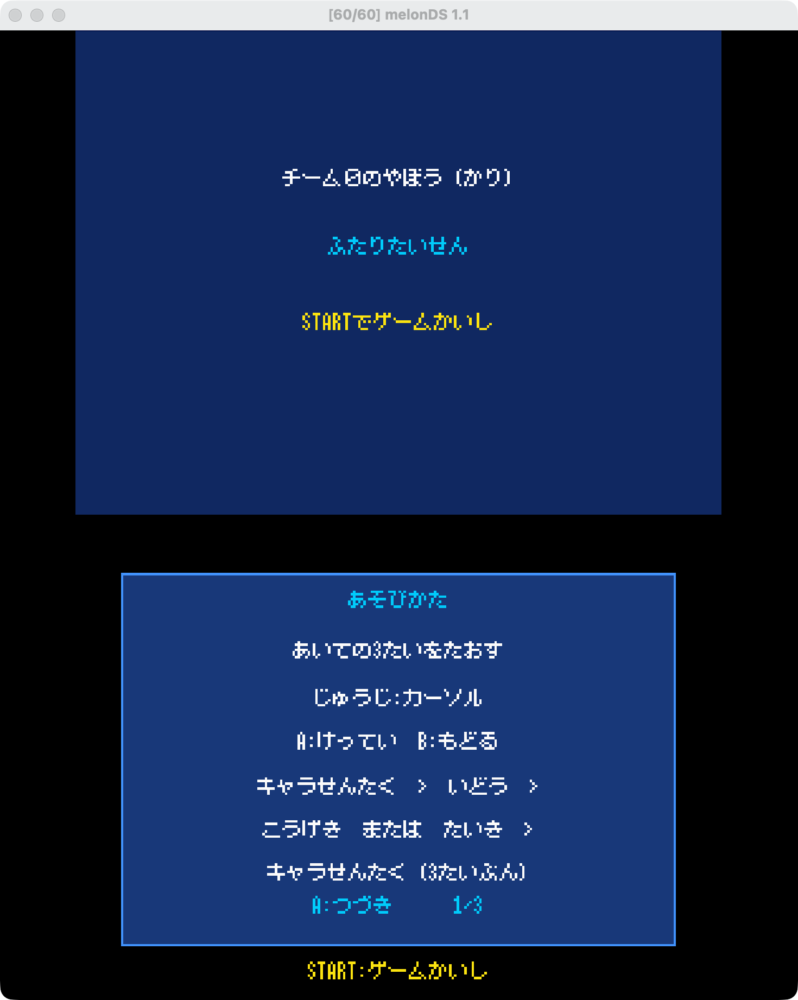
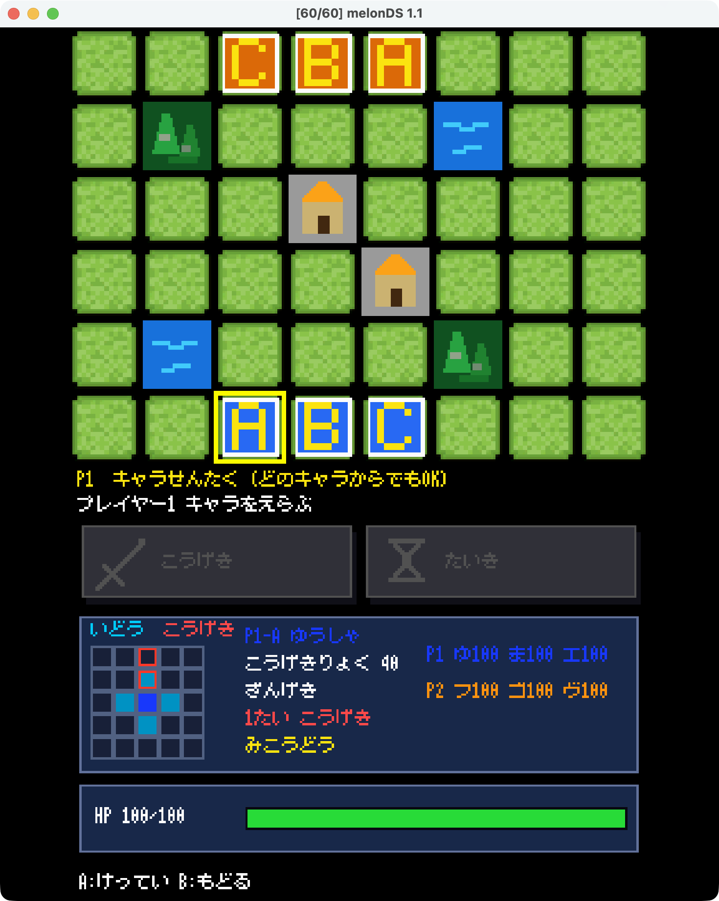
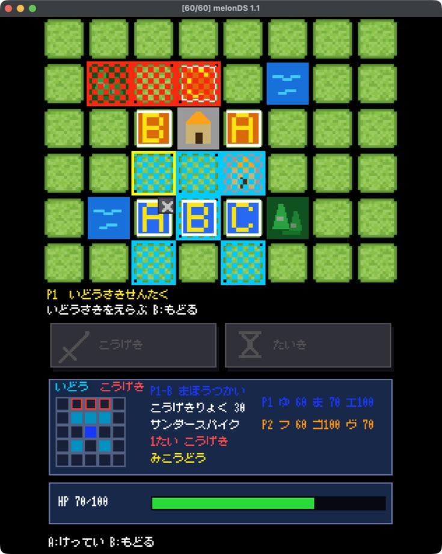
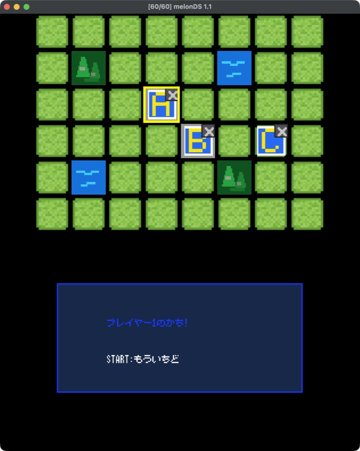
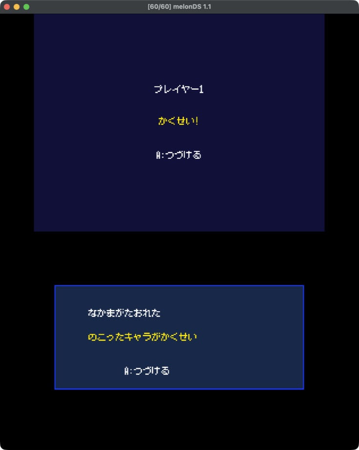
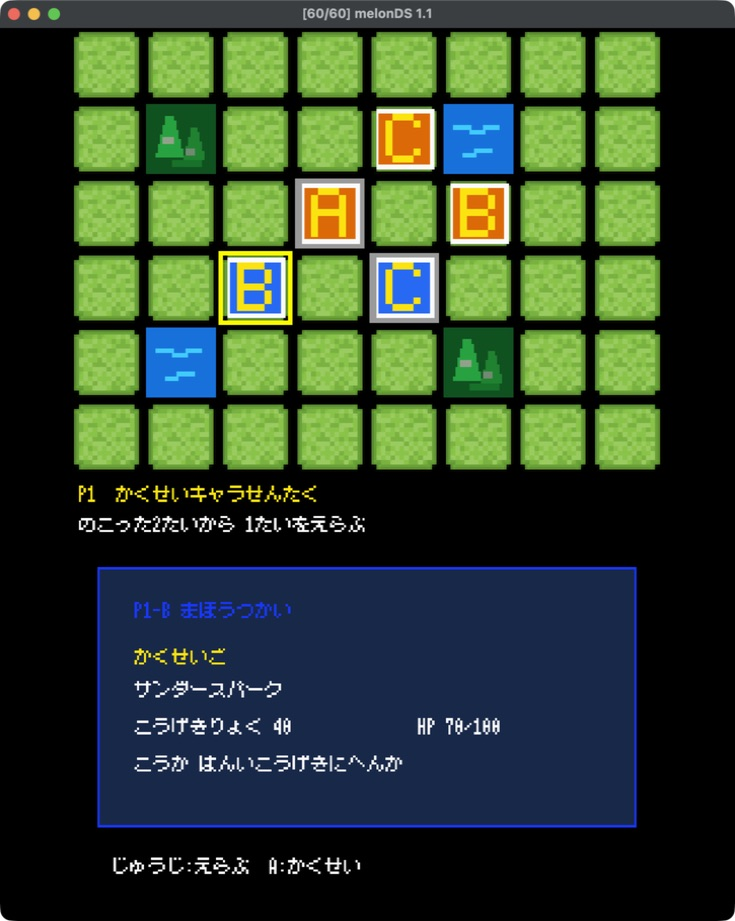
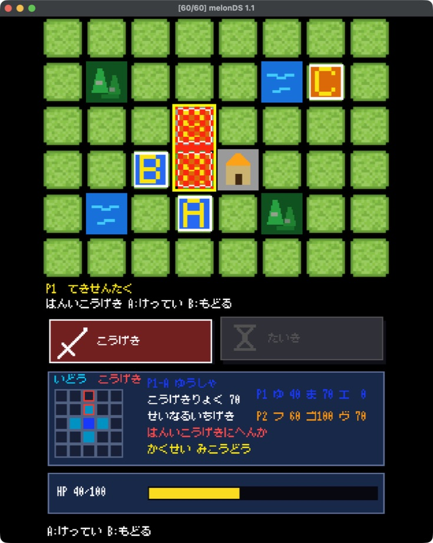
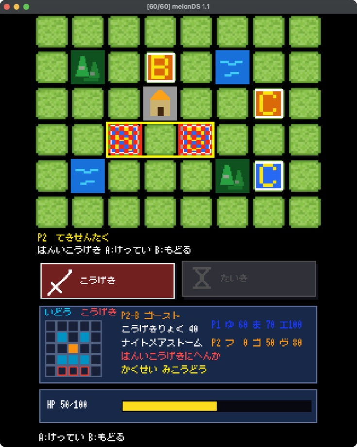

# チーム０のやぼう（仮）

## 1台を囲み、3体の使い分けと位置取りで相手との読み合いを楽しむ、2人対戦タクティクスゲーム。

相手の狙いを予想する緊張感と、ユニットの特性を活かした一手が決まる達成感を、友人と同じ盤面を囲みながら楽しむことを目指した。

プログラミングサークルWINCの夏合宿で、6人チームがNintendo DSi向けに制作した。各プレイヤーが特性の異なる3体を動かし、相手チームの全滅を目指す。

移動先からの攻撃範囲を決定前に確認しながら、「どこへ動かすか」「誰から行動させるか」を考える。合宿後には、味方を失った際に生存ユニットのうち1体を強化する「覚醒」も追加し、劣勢時にも次の一手を考えられる体験を目指している。

<p align="center">
  
  
</p>

<p align="center"><em>タイトル・遊び方／地形を含む対戦画面</em></p>

掲載画像は公開版のプレイ画面。素材の再配布条件に対応するため、キャラクター画像はA／B／Cの仮表示へ置き換えている。詳しくは[公開版について](#公開版について)を参照。

## 制作概要

| 項目 | 内容 |
|---|---|
| ジャンル | 2人対戦ターン制タクティクス |
| 対応環境 | Nintendo DSi／Nintendo DS、melonDS |
| 開発言語・環境 | C、BlocksDS、libnds、Docker、VS Code Dev Containers |
| チーム | プログラミングサークルWINCの6人チーム |
| 制作機会 | WINC 2026年夏合宿 |
| 合宿での開発期間 | 企画、実装、実機確認、発表準備を含めて実質約2.5日間 |
| 操作方式 | 1台の本体を2人で受け渡す共通操作方式 |

合宿では実質約2.5日間で対戦できる版を完成させた。その後、講評や友人とのプレイで得た気付きをもとに、情報表示、覚醒、地形、ゲームバランスを追加・改善している。本リポジトリの`main`は合宿後の改善を含む版であり、現在の全機能を約2.5日間で制作したものではない。

## 制作背景と企画意図

チーム内に『ポケモン＋ノブナガの野望』が好きなメンバーがいたことをきっかけに企画した。同作を再現するのではなく、Nintendo DSi上で短期間に完成可能な規模へ発想を再構成し、異なるルールとキャラクター性能を持つ対戦ゲームとして設計した。

### 想定する遊び手と場面

同じ場所にいる友人同士が、操作の速さではなく、位置取りや行動の選択で競う遊びを想定した。ターン制と1台交代操作を土台に、盤面の情報から自分なりの一手を考え、その結果を相手と共有できる体験を目指している。

### 1台を囲み、会話しながら遊ぶ

通信やプレイヤー別の操作系を用意せず、同じ十字キーとボタンを使ってターンごとに本体を受け渡す方式を採用した。開発規模を抑えるだけでなく、盤面を見ながら会話し、同じ場所で一緒に遊ぶ体験を意図している。

### DSiの2画面で判断を支える

上画面には8×6マスの盤面と、その場で可能な移動・攻撃範囲を表示する。下画面にはHP、技、ユニット固有の移動・攻撃範囲、行動状態、操作案内を表示する。小さな画面でも判断材料を読み取れるよう、色、枠、ドット絵、日本語の短い表現を組み合わせた。

### 決定前に判断材料を見せる

移動後に初めて攻撃可否が分かる状態を避けるため、移動候補へカーソルを合わせた時点で、その位置からの攻撃可能範囲を表示する。移動と攻撃を一続きの戦術判断として比較できる設計である。

<p align="center">
  
</p>

<p align="center"><em>移動候補にカーソルを合わせ、そこから届く攻撃範囲を確認する</em></p>

## 基本ルールと判断のポイント

Player 1から開始し、生存している自軍ユニットを好きな順番で1体ずつ行動させる。1体の行動は「移動または現在地に残る」「攻撃または待機」の順に進む。自軍の全員が行動すると相手のターンになり、相手の3体を先に倒した側が勝利する。

移動方法と攻撃範囲が異なるため、敵との距離だけでなく、攻撃を届かせられる位置や味方を動かす順番も判断材料になる。味方を失った後は、残ったユニットのうち誰を覚醒させるかを選ぶ。

| ユニット | 通常攻撃力 | 覚醒攻撃力 | 移動・攻撃の特徴 |
|---|---:|---:|---|
| A | 40 | 70 | 上下左右へ移動。通常時は前方1〜2マス内の敵1体を攻撃し、覚醒後は範囲内の敵をまとめて攻撃 |
| B | 30 | 40 | 斜めと前方へ移動。2マス前の横3マス内から、通常時は敵1体、覚醒後は範囲内の敵をまとめて攻撃 |
| C | 30 | 40 | 前後左右と前方斜めへ移動し、斜め4方向を攻撃。覚醒後は命中時に自身のHPを20回復 |

各プレイヤーは最初に味方を失った後、次の自分ターン開始時に生存ユニット1体を選んで覚醒させる。生存者が1体だけの場合は自動的に覚醒し、覚醒選択では行動回数を消費しない。

山と湖は進入不可。中央付近の建造物は進入でき、その上で自分のターンを迎えるとHPを20回復する。全ユニットの初期HPと最大HPは100。詳しい判定は[技術資料](mygame/docs/technical-notes.md)を参照。

## 操作

- 十字キー：カーソル移動、攻撃／待機の切り替え
- Aボタン：決定
- Bボタン：1段階戻る。移動後は移動前の位置へ戻る
- STARTボタン：ゲーム開始、勝敗決定後の再戦

対戦中にはBGMと選択時の効果音があり、勝敗画面でも効果音と再戦操作を案内する。

<p align="center">
  
</p>

## 合宿後の改善

機能を増やすだけでなく、判断に必要な情報の分かりやすさと、対戦中の選択肢を見直した。

### 表示の確認ではなく、次の行動を考えられるようにする

攻撃範囲がユニット画像に隠れる、行動済みかどうかを半透明表示だけでは見分けにくい、敵の能力を下画面で確認できない、といった課題に対応した。

| 課題 | 変更 | 狙い |
|---|---|---|
| 攻撃範囲と行動状態が分かりにくい | 表示の重なり順を調整し、行動済みの印を追加。所属色と攻撃範囲の色を区別 | 攻撃可能な相手と、まだ動かせる味方を判断しやすくする |
| 敵の能力やユニット固有の範囲を確認しにくい | 敵のHP・技・攻撃範囲を表示。下画面に移動・攻撃の固有パターンを併記 | 現在の盤面とユニット本来の特性を比較して考えられるようにする |
| 起動直後に対戦が始まり、目的や操作を把握しにくい | 勝利条件と操作を確認してから開始する遊び方画面を追加 | 初めて遊ぶ人にも、対戦に入るための情報を伝える |

変更記録：[PR #41](https://github.com/winc1980/2026-summer-camp-teamZero/pull/41)、[PR #44](https://github.com/winc1980/2026-summer-camp-teamZero/pull/44)、[PR #46](https://github.com/winc1980/2026-summer-camp-teamZero/pull/46)

### 特性の違いを使う対戦へ向けて初期配置を変更する

両陣営が同じ並びでは、同じ型同士が正面で向かい合い、特にA同士が早期に衝突しやすい課題があった。そこで片側の並びを反転し、異なる移動・攻撃特性を持つAとCによる追跡や回避を起こしやすくすることを狙った。

変更記録：[Issue #47](https://github.com/winc1980/2026-summer-camp-teamZero/issues/47)、[PR #48](https://github.com/winc1980/2026-summer-camp-teamZero/pull/48)

### 覚醒によって劣勢時の選択と役割の違いを増やす

当初はユニットごとに移動・攻撃範囲が異なる一方、攻撃結果はどれも敵1体への固定ダメージで、対戦中に性能が変わる仕組みがなかった。

そこで、味方を失った後に生存ユニット1体を強化する覚醒を追加した。A・Bは形状の異なる範囲攻撃、Cは攻撃時の自己回復へ変わる。残ったユニットのHPや敵の配置を見ながら、誰を覚醒させ、どう巻き返すかを考える選択を増やす狙いである。通常時の攻撃力も併せて調整した。

<p align="center">
  
  
</p>

<p align="center"><em>覚醒の告知／残ったユニットと現在HPを確認し、覚醒対象を選ぶ</em></p>

#### 判断例：BとCのどちらを覚醒させるか

上の選択画面では、味方Aを失い、BとCが残っている。Bを覚醒させると横方向の範囲攻撃になり、複数の敵を巻き込める位置を作る選択肢が生まれる。一方、Cを覚醒させると、攻撃を命中させた際に自身のHPを20回復し、戦い続けることを狙える。

どちらを選ぶかは、残った味方のHPだけでなく、敵を攻撃範囲へ捉えられる位置を作れるか、次に受ける攻撃をどう見込むかによって変わる。単に強いユニットを選ぶのではなく、現在の盤面から巻き返す方針を考える判断である。

<details>
<summary>覚醒A・Bの範囲攻撃を見る</summary>

<p align="center">
  
  
</p>

<p align="center"><em>覚醒Aの前方範囲攻撃／覚醒Bの横方向範囲攻撃</em></p>

</details>

変更記録：[Issue #49](https://github.com/winc1980/2026-summer-camp-teamZero/issues/49)、[PR #50](https://github.com/winc1980/2026-summer-camp-teamZero/pull/50)

### 地形によって進路と中央へ向かう価値を作る

全マスが草地の盤面では、ユニット固有の性能以外に位置取りを左右する要素がなかった。そこで、通れない山・湖と、自分のターン開始時にHPを20回復する建造物を追加した。

建造物を中央付近へ置き、距離を取るだけでなく、回復地点へ進むことにも価値を持たせた。障害物は最小限にし、中央への複数の進入経路を残している。進路と回復地点を踏まえた位置取りを考えられるようにする狙いである。

変更記録：[Issue #51](https://github.com/winc1980/2026-summer-camp-teamZero/issues/51)、[PR #52](https://github.com/winc1980/2026-summer-camp-teamZero/pull/52)

覚醒の強さ、地形配置、先攻・後攻のバランスは、引き続き対戦を重ねて検証・調整する課題としている。

## チーム開発とプロジェクトマネジメント

企画初期のアイデア出し、案の整理、盤面とUIの基本方針は、全員で1枚のホワイトボードを囲みながら決定した。

企画と基本仕様を決めた後、他メンバーが開発環境やC言語の学習を進める間に、高根が対戦に必要な機能を備えた[基盤MVP](https://github.com/YuTakane256/2026-summer-camp-tactics-mvp)を構築した。動くゲームで完成像とコード構成を早期に共有し、画面、画像、音源などを並行して追加できる土台を作った。

高根は、実装候補を次の情報とともにGitHub Issueへ分割し、担当調整、進捗確認、レビュー・統合、提出版管理も行った。

- ゲームの完成に対する優先度
- 現在のコードを踏まえた実装難易度と必要技術レベル
- 各メンバーの自己申告による技術レベル
- 各作業への希望・非希望
- 作業間の依存関係と競合の可能性

優先度を最初の判断基準としつつ、各メンバーが完了可能な難易度と、できる限り本人の希望に合う担当を組み合わせた。最初は各メンバーが1件をPull Requestまで進めることを目標とし、完了後に次のIssueへ進む段階的な割り当てを行った。作業が難航した場合は相談、レビュー、担当の引き継ぎによって、チーム全体で遊べる状態を完成させることを優先した。

短期間ですべての案を実装するのではなく、まず安定して対戦できる版を確保し、その後に優先度の高いUIや素材を段階的に統合した。採用しなかった案も削除せず、検討した仕様、難易度、優先度を[Issue](https://github.com/winc1980/2026-summer-camp-teamZero/issues)へ残している。実装とレビューの過程は[Pull Request](https://github.com/winc1980/2026-summer-camp-teamZero/pulls?q=is%3Apr)から確認できる。

なお、合宿後の[PR #36](https://github.com/winc1980/2026-summer-camp-teamZero/pull/36)は、合宿提出時の派生版にあったHPゲージ・技名表示を公開版へ統合した変更であり、合宿後の新規機能追加とは区別している。

### メンバーと主な担当

| メンバー | GitHub | 主な担当 |
|---|---|---|
| 高根 | [@YuTakane256](https://github.com/YuTakane256) | Issue設計、優先順位付けと必要技術レベルの分類、メンバーの技術レベルと希望を集計したうえでのIssue担当調整、進捗確認、レビュー・統合、提出版管理などのプロジェクトマネジメント。基盤MVP、対戦中の行動UI、選択中ユニット情報、移動先からの攻撃範囲表示、覚醒・地形を含む追加機能の統合、技術資料の整理 |
| 古根川 | [@kh928965-dot](https://github.com/kh928965-dot) | BlocksDS開発環境と初期画面表示、下画面の攻撃ボタン、草地タイルの盤面表示、選択中ユニットのHPゲージ表示 |
| 三橋 | [@Mihashy](https://github.com/Mihashy) | 初期プロトタイプ、キャラクター画像の選定・加工、盤面への画像組み込み |
| 中村 | [@ayanakamu34-wq](https://github.com/ayanakamu34-wq) | BGMと効果音の選定・組み込み、音源ライセンスの確認と記録 |
| 高橋 | [@yurikotori](https://github.com/yurikotori) | 草地タイルの最終画像制作、タイトル画面背景とスタートボタンの制作 |
| 足立 | [@Murasame-101](https://github.com/Murasame-101) | 山・川・建造物のタイル画像制作、勝敗決定後の結果画面の実装検討 |

この表は開発期間中に各メンバーが主に担当した領域を示すもの。短期開発のため、レビューや統合時には相互に修正、再実装、引き継ぎを行っており、現在のコードに残る行単位の所有範囲を示すものではない。

## 開発上の工夫

- ゲーム進行、盤面ルール、入力、描画、サウンドをファイル単位で分離
- DS固有処理に依存しないルール部分をホストPCでテストできる構成
- 選択、移動、攻撃、覚醒、ターン交代、勝敗を明確なフェーズとして管理
- ゲーム状態に変化がないフレームでは下画面を再描画せず、ちらつきを抑制
- 複数マス攻撃を、各マスのスプライト外周だけで一続きの枠として描画
- IssueとPull Requestを単位として分担し、統合前にビルドと動作を確認

## melonDSで遊ぶ

公開リポジトリでは生成済みのROMを配布していないため、用意済みのDev Containerで一度ビルドしてからmelonDSで起動する。

1. [Docker Desktop](https://www.docker.com/products/docker-desktop/)、[Visual Studio Code](https://code.visualstudio.com/)、[Dev Containers拡張機能](https://marketplace.visualstudio.com/items?itemName=ms-vscode-remote.remote-containers)を用意する。
2. このリポジトリの`Code`から`Download ZIP`を選んで展開するか、Gitでcloneする。
3. リポジトリをVisual Studio Codeで開き、コマンドパレットから`Dev Containers: Reopen in Container`を実行する。
4. コンテナ内のターミナルで`cd /work/mygame`、`make clean`、`make`の順に実行する。
5. [melonDS公式ダウンロードページ](https://melonds.kuribo64.net/downloads.php)から、使用しているOS向けのmelonDSを入手して起動する。
6. melonDSの`File`から`Open ROM`を選び、生成された`mygame/mygame.nds`を開く。
7. STARTボタンに割り当てられたキーを押してゲームを開始する。1台交代操作式のため、2人で同じキーボードまたはコントローラーを使用する。

操作に反応しない場合は、melonDSの`Config`にある`Input and hotkeys`を開き、十字キー、A、B、STARTへ任意のキーボードまたはコントローラー入力を割り当てる。詳しい設定方法は[melonDS公式FAQ](https://melonds.kuribo64.net/faq.php)を参照。

## ビルドと起動

DockerとVS Code Dev Containersを用意し、Dev Container内で実行する。

```bash
cd /work/mygame
make clean
make
```

成功すると`mygame/mygame.nds`が生成される。Nintendo DSi／Nintendo DS実機、または[melonDS](https://melonds.kuribo64.net/)で起動できる。

### ルールテスト

描画を除くゲームルールはPC上でも検証できる。

```bash
cd mygame
cc -std=c11 -Wall -Wextra -Werror -Isource \
  test/test_rules.c source/game.c source/board.c source/unit.c \
  -o /tmp/mygame-rule-tests
/tmp/mygame-rule-tests
```

`All game rule tests passed.`と表示されれば成功。

## リポジトリ構成

```text
mygame/
├── audio/      BGM・効果音
├── docs/       技術資料・利用素材のライセンス
├── graphics/   盤面画像と変換設定
├── source/     ゲーム本体
└── test/       ゲームルールと描画のテスト
```

## 公開版について

合宿発表版と非公開の講評提出版では、DOT ILLUSTの素材を加工し、6体のキャラクター画像としてゲームへ組み込んだ。一方、同サイトの利用条件では素材そのものや加工素材の再配布が禁止されているため、公開GitHubリポジトリの`main`からは元画像と加工PNGを意図的に除外している。

公開版では、コードで生成したA／B／Cの仮ユニットへ置き換えている。キャラクター画像以外のゲームルール、UI、覚醒、地形などはそのまま動作し、公開版だけでビルドと対戦が可能である。今後、公開・再配布が明確に認められた独自素材へ置き換える予定。

非公開版では、各陣営のA／B／Cに次のキャラクター画像を割り当てている。表示名と技名も画像の題材に合わせており、公開版でも同じ性能と技名を使用している。

| 陣営・型 | 非公開版のキャラクター | 通常技 | 覚醒技 |
|---|---|---|---|
| P1-A | 勇者 | ざんげき | せいなるいちげき |
| P1-B | 魔法使い | サンダースパイク | サンダースパーク |
| P1-C | エルフ | フェアリーアロー | フェアリーブレス |
| P2-A | フランケン | パワースマッシュ | ボルトクラッシュ |
| P2-B | ゴースト | ポルターガイスト | ナイトメアストーム |
| P2-C | ヴァンパイア | ブラッドバイト | ブラッドドレイン |

### 使用素材

- [美咲フォント](mygame/docs/misaki-font-license.md)
- [EASY 8BIT EDITOR](mygame/docs/easy-8bit-editor-license.md)
- [EASY 8BIT SFX](mygame/docs/easy-8bit-sfx-license.md)
- [盤面画像素材](mygame/docs/forest-town-license.md)
- [DOT ILLUST利用規約](https://dot-illust.net/terms/) - 非公開版のキャラクター画像に利用

第三者素材の著作権は各権利者に帰属する。本リポジトリ全体へ適用するライセンスは未決定であり、各素材にはリンク先の条件が適用される。

## Known Issues・今後の拡張

現時点で、対戦の進行を妨げる既知の不具合は確認されていない。

- 公開版のキャラクター画像を、再配布可能な独自素材へ置き換える
- 覚醒後の攻撃力、地形配置、先攻・後攻のバランスを対戦回数を増やして調整する
- 攻撃時の効果音と、勝敗決定音が重ならない再生制御を追加する
- P2ターン時の盤面回転など、1台交代操作をさらに分かりやすくする
- 地形相性、キャラクター固有能力、追加マップを検討する
- タッチ操作へ対応する
